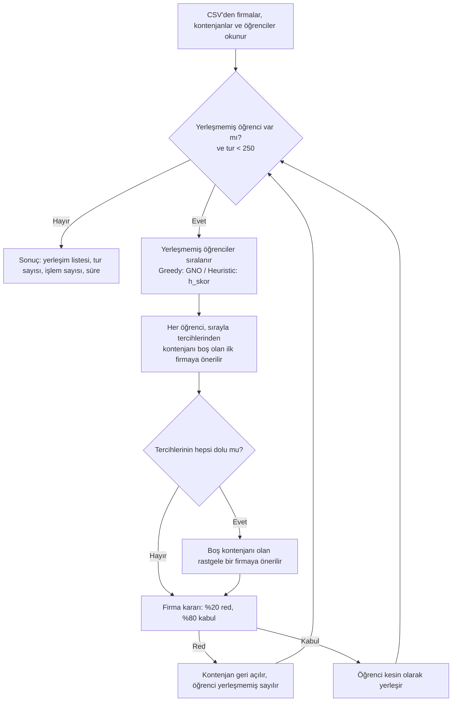

# Stajyer Yerleştirme Simülatörü

Öğrencileri, tercihlerine ve not ortalamalarına (GNO) göre kontenjanı sınırlı firmalara yerleştiren bir simülasyon. Gerçek hayattaki gibi firmalar önerilen stajyeri **reddedebiliyor**. Reddedilen öğrenci bir sonraki turda yeniden yerleştiriliyor. Aynı veri üzerinde iki yerleştirme stratejisi, **Greedy** ve **Heuristic**, yan yana çalıştırılıp karşılaştırılıyor.

Proje, Tkinter ile yazılmış bir masaüstü arayüzüyle (akademisyen paneli) birlikte geliyor.

## Problem

| | |
|---|---|
| **Öğrenci** | 120 öğrenci. Her birinin GNO'su (2,00–4,00) ve sıralı 5 firma tercihi var |
| **Firma** | 50 firma. Her birinin 1–5 arası kontenjanı var |
| **Kısıt** | Bir firmaya kontenjanından fazla öğrenci yerleştirilemez |
| **Belirsizlik** | Firma, önerilen öğrenciyi **%20 olasılıkla reddeder** (`RED_ORANI = 0.2`) |
| **Amaç** | Öğrencileri olabildiğince üst sıradaki tercihlerine yerleştirmek |

## Simülasyon akışı

Her iki algoritma da aynı tur yapısını kullanıyor. Yalnızca öğrencilerin **hangi sırayla** yerleştirileceği farklı.



Her öğrencinin durumu üç aşamadan geçer: `Yerlesmedi` → `Onerildi` → `Yerlestirildi`. Firma reddederse öğrenci tekrar `Yerlesmedi` durumuna döner.

## Algoritmalar

### Greedy: başarı sıralı ([greedy.py](greedy.py))
Yerleşmemiş öğrenciler her turda **yalnızca GNO'ya göre** büyükten küçüğe sıralanır. En yüksek ortalamalı öğrenci tercihlerini ilk seçer. Basit ve açıklanabilir bir yöntem: "Kim daha başarılıysa önce o seçer."

### Heuristic: esnek yaklaşım ([heuristic.py](heuristic.py))
Önce her firmanın **popülerliği**, yani kaç öğrencinin o firmayı tercih ettiği hesaplanır. Sonra her öğrenciye bir skor verilir:

```
h_skor = 2,0 × GNO  +  0,05 × (tercih ettiği firmaların ortalama popülerliği)  +  rastgele(−0,1, +0,1)
```

- **GNO** hâlâ en baskın etken.
- **Popülerlik terimi**, çok talep gören firmaları isteyen öğrencileri biraz öne alır. Böylece popüler firmalardaki tıkanma azaltılmaya çalışılır.
- **Küçük rastgelelik**, GNO'ları birbirine çok yakın öğrencilerde sıralamanın hep aynı kişilerin lehine işlemesini önler.

### Karşılaştırma ölçütleri
Final raporunda iki yöntem şu ölçütlerle karşılaştırılır:

| Ölçüt | Anlamı |
|---|---|
| Toplam tur | Herkes yerleşene kadar kaç tur gerektiği (en fazla 250) |
| Deneme | Toplam yerleştirme denemesi sayısı |
| Süre | Algoritmanın çalışma süresi (saniye) |
| **Memnuniyet skoru** | 1. tercihe yerleşen öğrenci 5 puan, 2. tercih 4 puan … 5. tercih 1 puan, tercih listesi dışı (rastgele) yerleşme 0 puan. Tüm öğrencilerin puanları toplanır |

## Arayüz ([gui_app.py](gui_app.py))

- **Akademisyen girişi:** Demo için sabit kullanıcı bilgileri kullanılıyor: `akademisyen` / `1234`.
- **Ana panel:** Greedy ve Heuristic sonuçları yan yana iki tabloda gösterilir. Satır renkleri şöyle:
  - 🟩 Yeşil: 1. tercihine yerleşti
  - 🟦 Mavi: 2.–5. tercihlerinden birine yerleşti
  - 🟥 Kırmızı: Tercihleri dolu olduğu için rastgele bir firmaya yerleşti
- **Öğrenci arama:** ID'ye göre anlık filtreleme.
- **Öğrenci detayı:** Bir öğrenciye çift tıklayınca tercih listesi açılır. Yerleştiği firma işaretli gösterilir.
- **Adım adım analiz:** Her tur tek tek ilerletilir. Hangi öğrencinin hangi firma tarafından reddedildiği ve kalan kontenjan iki algoritma için ayrı ayrı izlenebilir.
- **Final raporu:** Performans özeti tablosu ve firma bazında "hangi firmaya kimler yerleşti" listesi.

## Veri

| Dosya | İçerik |
|---|---|
| `uretilenStajVerileri.csv` | `veri_uret.py` ile üretilen sentetik veri: 50 firma (`Firma_1`…`Firma_50`), toplam 161 kontenjan, 120 öğrenci. **Arayüz varsayılan olarak bu dosyayı kullanır** |
| `hazırStajVerileri.csv` | Gerçek firma adlarıyla hazırlanmış örnek veri: 50 firma, toplam 120 kontenjan, 120 öğrenci |

CSV biçimi: `;` ile ayrılmış, `iso-8859-9` (Türkçe) kodlamalı. Ondalık ayırıcı virgül (örneğin `3,25`). Öğrenci tercihleri tek bir hücrede, virgülle ayrılmış olarak tutulur.

[veri_uret.py](veri_uret.py), öğrenci sayısı, firma sayısı, tercih sayısı, kontenjan aralığı, GNO aralığı ve tohum değeri (`seed`) parametreleriyle **tekrar üretilebilir** sentetik veri oluşturur.

## Kurulum ve çalıştırma

Gereksinimler: Python 3.9+, `pandas`, `numpy`. Tkinter Python ile birlikte gelir.

```bash
pip install pandas numpy

# (İsteğe bağlı) Sentetik veriyi yeniden üret
python veri_uret_calistir.py

# Arayüzü başlat
python gui_app.py
```

Giriş ekranında `akademisyen` / `1234` ile giriş yapın ve **Simülasyonu Başlat**'a basın.

## Dosya yapısı

```
├── gui_app.py                 # Tkinter arayüzü ve veri yükleme (StajSimulasyonu sınıfı)
├── greedy.py                  # GNO sıralı yerleştirme
├── heuristic.py               # GNO + popülerlik skorlu yerleştirme
├── veri_uret.py               # Sentetik veri üreteci
├── veri_uret_calistir.py      # Üreteci varsayılan parametrelerle çalıştırır
├── uretilenStajVerileri.csv   # Üretilmiş veri (varsayılan)
└── hazırStajVerileri.csv      # Gerçek firma adlı örnek veri
```

## Bilinen sınırlamalar ve geliştirme fikirleri

- **Adım adım analiz ekranındaki Heuristic sıralaması**, `heuristic.py`'deki skordan farklı: GNO'yu 0,85–1,15 arası rastgele bir katsayıyla çarpıyor ve popülerliği kullanmıyor. Bu yüzden adım adım sonuçlar, "Simülasyonu Başlat" sonuçlarıyla birebir aynı olmayabilir. Bu ekranda da `heuristic.py`'deki skorun kullanılması tutarlılığı sağlar.
- Firma reddi ve rastgele atama `random` modülünü tohum değeri olmadan kullanıyor. Bu yüzden her çalıştırmada sonuçlar biraz değişir. Karşılaştırmayı adil yapmak için sabit bir tohum değeri ve birden çok çalıştırmanın ortalaması kullanılabilir.
- `hazırStajVerileri.csv` dosyasında Türkçe karakterler bozulmuş durumda. Sütun başlıkları da bozulduğu için dosya bu hâliyle arayüzde yüklenemiyor, yeniden kaydedilmesi gerekiyor.
- Giriş bilgileri demo amaçlı olarak kodun içinde duruyor. Gerçek bir kullanımda ayrı bir yapılandırma ya da kimlik doğrulama sistemi gerekir.
- Kararlı eşleştirme (Gale–Shapley gibi) algoritmalarla karşılaştırma eklenebilir.
